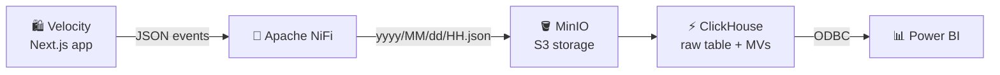
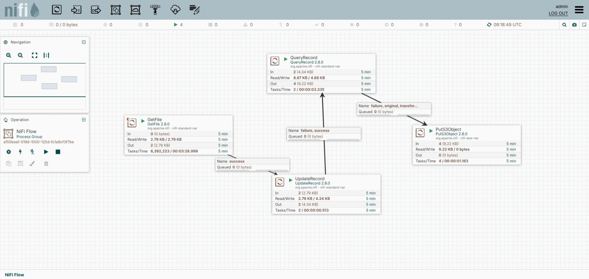
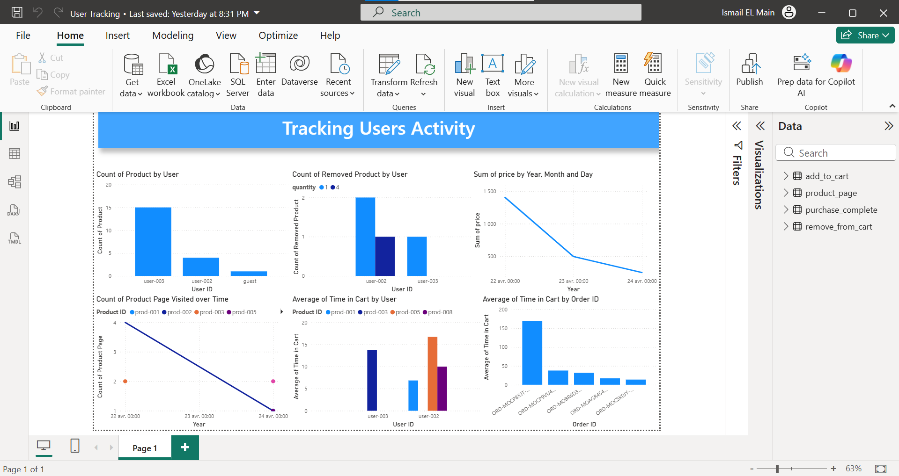

<div align="center">

# ⚡ Velocity — E-commerce Sport Tracking

### End-to-end user activity tracking pipeline
**Next.js → Apache NiFi → MinIO → ClickHouse → ODBC → Power BI**

<br/>


<br/>

[📖 Overview](#-project-overview) •
[📡 Events](#-tracked-events) •
[🔄 Pipeline](#-data-pipeline) •
[📊 Dashboard](#-power-bi-dashboard) •
[🛠️ Stack](#%EF%B8%8F-tech-stack) •
[🚀 Getting Started](#-getting-started)

</div>

---

## 🚀 Project Overview

**Velocity** is a fictional sports e-commerce website built as the data source for an end-to-end **user activity tracking pipeline**. The app generates events such as product page visits, add-to-cart actions, cart removals and completed purchases. Those events are written as local JSON files, then processed through **Apache NiFi, MinIO, ClickHouse, ODBC and Power BI**.

This repository combines two parts:

| Part | Description |
|------|-------------|
| 🛍️ **Front-end** | A Next.js app simulating the *Velocity* sports store |
| 🧱 **Data pipeline** | Turns raw user events into analytics-ready tables and a Power BI dashboard |

> 🎯 **Goal:** demonstrate a realistic event tracking workflow that mirrors how modern product analytics pipelines are built in production.

---

## 📡 Tracked Events

| Event | Description |
|-------|-------------|
| 👀 `product_page` | A user opens a product page and views product details |
| 🛒 `add_to_cart` | A product is added to the cart |
| ❌ `remove_from_cart` | A product is removed from the cart |
| ✅ `purchase_complete` | A checkout is completed successfully |

Each event is stored as JSON and includes metadata such as user information, product identifiers, cart totals, quantity, color, size, page details and timestamps.

---

## 🔄 Data Pipeline



### 1️⃣ Event generation in Velocity

Velocity acts as the source system. User interactions are captured in the application and stored locally as JSON files, creating a reproducible event stream without requiring a live production backend.

### 2️⃣ Apache NiFi ingestion and transformation

NiFi orchestrates the data flow with four processors:

| Processor | Role |
|-----------|------|
| `GetFile` | Reads the JSON files from the local source folder |
| `UpdateRecord` | Flattens nested fields, especially values under `/metadata/` |
| `QueryRecord` | Cleans and reshapes records, including timestamp normalization with `REPLACE` |
| `PutS3Object` | Writes the transformed files to object storage |

This reflects a common real-world pattern: ingest raw events, standardize the schema, and land them in durable object storage before loading them into the warehouse.

<div align="center">



*Apache NiFi workflow*

</div>

### 3️⃣ MinIO object storage

MinIO is used as an S3-compatible landing zone for the transformed JSON files. Files are partitioned by date and hour:

```text
yyyy/MM/dd/HH.json
```

This supports incremental processing, replay and time-based backfills.

### 4️⃣ ClickHouse analytics layer

ClickHouse consumes the MinIO data through a **raw stream table** and **materialized views**. The repository includes event-oriented tables and views for:

- `add_to_cart`
- `product_page`
- `purchase_complete`
- `remove_from_cart`

These structures make the data easy to query for behavioral analysis, conversion tracking and funnel exploration.

### 5️⃣ ODBC connectivity

An ODBC data source on Windows connects Power BI directly to ClickHouse.

| Setting | Value |
|---------|-------|
| **Data source name** | `User Tracking` |
| **Host** | `localhost:8123` |
| **Database** | `default` |

---

## 📊 Power BI Dashboard

The final layer is a Power BI dashboard titled **`Tracking Users Activity`**, with six main charts:

| # | Chart |
|---|-------|
| 1 | 🛒 Products added by user |
| 2 | ❌ Products removed by user |
| 3 | 💰 Revenue by day |
| 4 | 📈 Product page visits over time |
| 5 | ⏱️ Average time in cart by user |
| 6 | 🧾 Average time in cart by order |

<div align="center">



*Tracking Users Activity dashboard*

</div>

---

## ✨ Why This Pipeline Matches Best Practice

| Principle | How it applies |
|-----------|----------------|
| 🧩 **Separation of concerns** | The app generates events, NiFi transforms them, MinIO stores them, ClickHouse serves analytics, Power BI handles reporting |
| 🧹 **Schema normalization** | Nested JSON is flattened before warehouse ingestion, reducing downstream query complexity |
| 💾 **Durable landing zone** | Object storage keeps a replayable copy of the data for reprocessing and recovery |
| 🕒 **Time partitioning** | Day and hour partitions support incremental reads and easier backfills |
| ⚡ **Analytics-optimized serving** | ClickHouse is well suited for high-speed aggregations and dashboard workloads |
| 🔌 **BI decoupling** | Power BI reads from ClickHouse instead of the raw source, keeping reporting stable and performant |

> In short, the pipeline mirrors a production-style **ELT / analytics flow**: event capture → file landing → transformation → warehouse modeling → business intelligence.

---

## 🛠️ Tech Stack

| Layer | Technologies |
|-------|--------------|
| **Front-end** | Next.js 16 · React 19 · TypeScript · Tailwind CSS |
| **Ingestion** | Apache NiFi |
| **Storage** | MinIO |
| **Analytics** | ClickHouse |
| **Connectivity** | ODBC (Windows) |
| **BI** | Power BI |

---

## 📁 Repository Structure

```text
.
├── app/            # Next.js app routes and pages
├── components/     # Shared UI and dashboard components
├── hooks/          # React hooks used across the app
├── lib/            # Stores, types, data helpers and utilities
├── public/images/  # Static assets
└── styles/         # Global styling
```

---

## 🚀 Getting Started

### Prerequisites

- Node.js 18+ recommended
- pnpm, npm or yarn

### Install dependencies

```bash
pnpm install
# or
npm install
```

### Run the development server

```bash
pnpm dev
# or
npm run dev
```

Then open **[http://localhost:3000](http://localhost:3000)**.

### Build and start for production

```bash
pnpm build
pnpm start
```

---

## 📬 Contact

<div align="center">

[](https://github.com/ismail703)
[](https://www.linkedin.com/in/ismail-el-main/)

<br/>

⭐ *If you found this project useful, consider giving it a star!*

</div>
